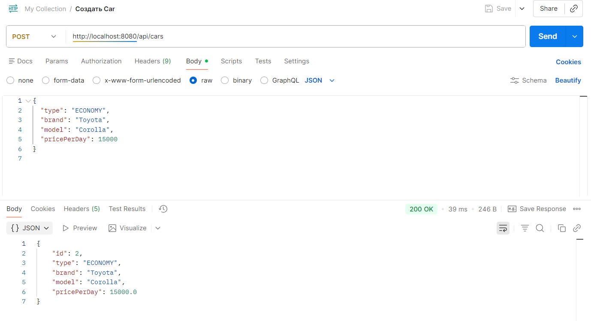
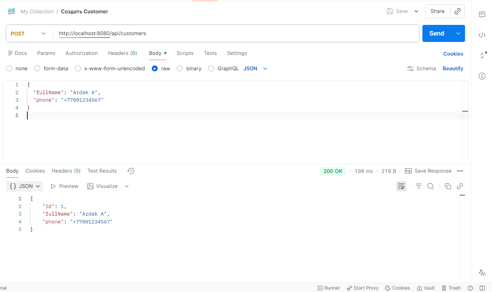
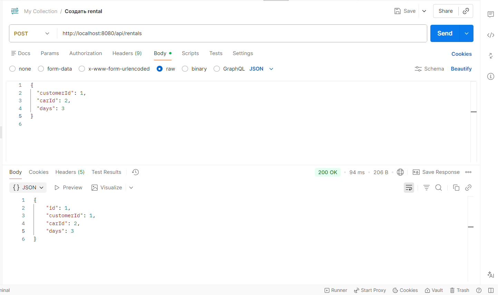

# 🚗 Avto Car Rental API

Spring Boot RESTful API for managing car rentals.  
This project demonstrates a clean backend architecture with REST principles, JDBC database integration, and classic design patterns.

---


## 📌 Project Overview

**Avto Car Rental API** is a backend system that allows:

- managing cars
- managing customers
- creating rentals (car bookings)

The project was developed as an **end-term project** with focus on:
- Design Patterns
- SOLID principles
- Component principles
- Clean RESTful API architecture

---

## 🏗️ System Architecture

The application follows a **layered architecture**:

Controller → Service → Repository → Database


### Package Structure
controller – REST endpoints
service – business logic
repository – JDBC database access
model – domain models
dto – request/response objects
patterns – design patterns (Factory)
utils – Singleton configuration & logger
exception – custom exceptions & global handler


---

## 🛢️ Database

- **Database:** PostgreSQL
- **Tool:** pgAdmin
- **Access:** JDBC (JdbcTemplate)

Database schema is defined in:

src/main/resources/schema.sql


### Tables
- `cars`
- `customers`
- `rentals`

---

## 🔗 REST API Endpoints

### 🚘 Cars

| Method | Endpoint | Description |
|------|--------|------------|
| POST | `/api/cars` | Create a car |
| GET | `/api/cars` | Get all cars |
| GET | `/api/cars/{id}` | Get car by id |
| PUT | `/api/cars/{id}` | Update car |
| DELETE | `/api/cars/{id}` | Delete car |

**POST /api/cars – example**
```json
{
  "type": "ECONOMY",
  "brand": "Toyota",
  "model": "Corolla",
  "pricePerDay": 15000
}
👤 Customers
Method	Endpoint	Description
POST	/api/customers	Create customer
GET	/api/customers	Get all customers
GET	/api/customers/{id}	Get customer by id
POST /api/customers – example

{
  "fullName": "Ardak A",
  "phone": "+77001234567"
}
📅 Rentals
Method	Endpoint	Description
POST	/api/rentals	Create rental
GET	/api/rentals	Get all rentals
GET	/api/rentals/{id}	Get rental by id
POST /api/rentals – example

{
  "customerId": 1,
  "carId": 1,
  "days": 3
}
🧩 Design Patterns
🔒 Singleton Pattern
Used for:

application configuration

logging service

Classes:

AppConfig

AppLogger

Ensures that only one instance exists across the application.

🏭 Factory Pattern
Used for creating car objects.

Implementation:

VehicleBase – abstract base class

EconomyCar, LuxuryCar – subclasses

VehicleFactory – creates objects based on VehicleType

Factory returns the base type, making the system easy to extend.

🧱 Builder Pattern
Used for constructing Rental objects.

Rental has multiple required fields, so Builder provides:

readable object creation

validation before creation

Example:

Rental rental = new Rental.Builder()
    .customerId(1L)
    .carId(2L)
    .days(3)
    .build();
📦 Component Principles
REP (Reuse/Release Equivalence Principle)
Reusable modules (repository, utils) are separated.

CCP (Common Closure Principle)
Classes that change together are grouped together.

CRP (Common Reuse Principle)
Packages avoid forcing dependencies on unused classes.

🧱 SOLID Principles
Single Responsibility – each class has one responsibility

Open/Closed – new car types can be added without modifying existing code

Liskov Substitution – subclasses replace base classes correctly

Interface Segregation – clean repository interfaces

Dependency Inversion – controllers depend on services

⚠️ Error Handling
Global exception handling is implemented.

Examples:

404 Not Found – resource does not exist

400 Bad Request – invalid input

Errors are returned as JSON responses.

▶️ How to Run the Project
Create PostgreSQL database:

avto_car_rental
Configure database connection in:

application.properties
Run the application:

AvtoCarRentalApiApplication
Test endpoints using Postman
```

### Create Car (POST /api/cars)


