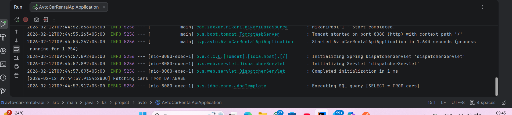
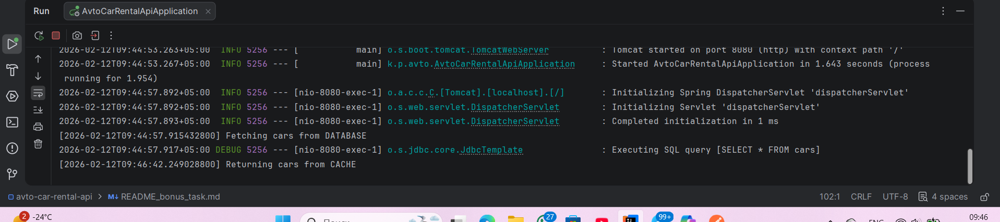

# 🚀 Bonus Task – In-Memory Caching Implementation

## 📌 Overview

As a bonus task, a simple **in-memory caching mechanism** was implemented to improve system performance.

The goal of this feature is to reduce unnecessary database queries by storing frequently requested data in memory.

---

## 🧠 What Was Implemented

A lightweight caching system using:

- Java `Map<String, Object>`
- Singleton pattern
- Cache invalidation on data updates

The cache stores results of frequently accessed data such as:

## GET/api/cars

---

## 🏗️ Implementation Details

### 1️⃣ SimpleCache (Singleton)

Location: src/main/java/kz/project/avto/utils/SimpleCache.java

This class:
- Stores data in memory using `HashMap`
- Ensures only one instance exists (Singleton)
- Provides methods:
    - `put(key, value)`
    - `get(key)`
    - `remove(key)`
    - `clear()`

The cache exists during application runtime only.

---

### 2️⃣ Cache Integration in Service Layer

The caching logic was implemented inside: CarService.java

Specifically in the method: getAll()

### 🔁 Behavior

1. First request:
    - Data is fetched from the database
    - Result is stored in cache
    - Log: `"Fetching cars from DATABASE"`

2. Second request:
    - Data is returned from cache
    - No database query executed
    - Log: `"Returning cars from CACHE"`

---

### 3️⃣ Cache Invalidation

To ensure data consistency, cache is cleared after:

- `create()`
- `update()`
- `delete()`

This guarantees that stale data is never returned.

Example:
```
cache.remove("cars");

🔒 Design Patterns Used
Singleton Pattern

    SimpleCache is implemented as a Singleton.
    Ensures only one cache instance exists across the application.


⚙️ Why This Is Important
# This feature demonstrates:

    Understanding of performance optimization
    Real-world backend architecture practice
    Separation of concerns (cache is handled in service layer)
    Proper use of design patterns
```
## Demonstration

When calling: GET /api/cars

First call:


Second call:
Returning cars from CACHE


This confirms that the cache is working correctly.

Conclusion

The implemented caching system:

    Reduces database load
    
    Improves response performance

    Uses clean architecture principles

    Maintains data consistency through cache invalidation

    The solution is simple, lightweight, and fully integrated into the existing Spring Boot architecture


